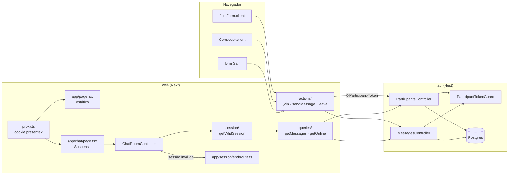

# Chat básico: entrar, histórico, enviar e sair (F1) Design

**Spec**: `.specs/features/chat-core/spec.md`
**Status**: Draft

---

## Architecture Overview

A F1 cria o domínio nos dois apps e remove `examples` (D1).

- **api**: módulo `chat` com participantes e mensagens, guard de token, e a migration que troca `Example` pelas tabelas do chat.
- **web**: feature `chat` com sessão em cookie, `proxy.ts` para os redirects (AD-002), Server Actions para escrever e containers para ler. O navegador só fala com o Next.



**Fluxo de entrada:** `JoinForm` → `join` (zod) → `POST /chat/participants` → cookie `chat_session` → `redirect('/chat')`.
**Fluxo da sala:** `proxy` deixa passar (cookie presente) → `ChatRoomContainer` → `getValidSession()` (cookie + `GET /participants/online`) → `getMessages({ limit: 50 })` → `ChatRoomView`.
**Fluxo de envio:** `Composer` → `sendMessage` → `POST /chat/messages` → `refresh()`.
**Fluxo de saída:** `form` do `ChatHeader` → `leave` → `POST /participants/:id/leave` (falha ignorada) → apaga o cookie → `redirect('/')`.

---

## Code Reuse Analysis

### Existing Components to Leverage

| Component                                     | Location                                                 | How to Use                                                                     |
| --------------------------------------------- | -------------------------------------------------------- | ------------------------------------------------------------------------------ |
| Estrutura do módulo `examples`                | `apps/api/src/modules/examples/`                         | Molde de pastas, DTOs, mapper, testes e `test-fixtures.ts`                     |
| `PrismaExceptionFilter`                       | `apps/api/src/common/filters/prisma-exception.filter.ts` | Converte a violação do índice único parcial (`P2002`) em `409` sem código novo |
| `AppConfigService`, `PrismaService`           | `apps/api/src/common/`                                   | Injeção normal                                                                 |
| `setupApp()` + e2e                            | `apps/api/src/app/app.setup.ts`, `test/app.e2e-spec.ts`  | Novo `test/chat.e2e-spec.ts` no mesmo formato                                  |
| `getApi()`, `getEnv()`                        | `apps/web/src/lib/api.ts`, `env.ts`                      | Único ponto de chamada à api                                                   |
| Padrão `createExample`                        | `features/examples/actions/create-example.ts`            | `join` segue o mesmo formato (zod, 409 vira erro no campo, `refresh()`)        |
| Padrão container + `<Suspense>` + `error.tsx` | `app/examples/`                                          | `/chat` segue igual                                                            |
| MSW (`test/msw/server.ts`)                    | `apps/web/test/`                                         | Testes de queries, actions e route handlers                                    |
| Componentes e tokens da F0                    | `features/chat/components/`, `components/ui/`            | A F1 só liga dados                                                             |

### Integration Points

| System         | Integration Method                                                                                                                        |
| -------------- | ----------------------------------------------------------------------------------------------------------------------------------------- |
| Contrato       | DTOs com `@ApiProperty` → `npm run generate` → `Schemas['MessageResponseDto']` etc. em `chat.types.ts` (substitui os tipos manuais da F0) |
| Banco          | Migration nova `chat_init`; a migration `20261014150117_init` (Example) é apagada, como manda o §12 do ARCHITECTURE da api                |
| Docker Compose | Healthcheck do web passa de `/examples` para `/`                                                                                          |
| E2E            | `e2e/chat.spec.ts` + `e2e/pages/{join,room}.page.ts`; `examples.spec.ts` sai                                                              |

---

## Components (api)

### Módulo `chat`

```
apps/api/src/modules/chat/
├── controllers/        participants.controller.ts, messages.controller.ts
├── services/           participants.service.ts, messages.service.ts
├── repositories/       participant.repository(.interface).ts, message.repository(.interface).ts
├── dtos/request/       join-participant.dto.ts, send-message.dto.ts, list-messages.query.ts
├── dtos/response/      participant-joined-response.dto.ts, online-participants-response.dto.ts,
│                       message-response.dto.ts, messages-response.dto.ts
├── mappers/            message.mapper.ts, participant.mapper.ts
├── guards/             participant-token.guard.ts
├── decorators/         current-participant.decorator.ts
├── security/           participant-token.ts
├── test-fixtures.ts    makeParticipant(), makeMessage()
└── chat.module.ts
```

### `ParticipantsController`

- **Purpose**: Entrar, listar online e sair.
- **Location**: `modules/chat/controllers/participants.controller.ts`
- **Interfaces**: `@Controller('chat/participants')`, `@SkipThrottle()` (AD-004), `@ApiTags('Chat')`
  - `POST /` `join(@Body() dto: JoinParticipantDto): Promise<ParticipantJoinedResponseDto>` → `201`; `400`, `409`
  - `GET /online` `listOnline(): Promise<OnlineParticipantsResponseDto>` → `200`
  - `POST /:id/leave` `@UseGuards(ParticipantTokenGuard)` `@HttpCode(204)` `leave(@Param('id', ParseUUIDPipe) id, @CurrentParticipant() actor): Promise<void>` → `204`; `401`, `404`
- **Dependencies**: `ParticipantsService`
- **Reuses**: decorators de Swagger como no `ExampleController`

### `MessagesController`

- **Purpose**: Listar e enviar mensagens.
- **Location**: `modules/chat/controllers/messages.controller.ts`
- **Interfaces**: `@Controller('chat/messages')`, `@SkipThrottle()`
  - `GET /` `list(@Query() query: ListMessagesQuery): Promise<MessagesResponseDto>` → `200`; `400`
  - `POST /` `@UseGuards(ParticipantTokenGuard)` `send(@CurrentParticipant() actor, @Body() dto: SendMessageDto): Promise<MessageResponseDto>` → `201`; `400`, `401`
- **Dependencies**: `MessagesService`

### `ParticipantTokenGuard` + `@CurrentParticipant()`

- **Purpose**: Autenticar pelo header `X-Participant-Token` (JOIN-02 AC8, SEND-02 AC8).
- **Location**: `modules/chat/guards/`, `modules/chat/decorators/`
- **Interfaces**:
  - `canActivate(ctx)`: lê o header; ausente → `UnauthorizedException`; `participantsService.authenticate(token)` → `null` → `401`; senão grava `request.participant`
  - `@CurrentParticipant()` devolve o `Participant` do request
  - Cada rota protegida declara `@ApiHeader({ name: 'X-Participant-Token', required: true })` e `@ApiUnauthorizedResponse`, para o header entrar no tipo gerado
- **Dependencies**: `ParticipantsService`

### `ParticipantsService`

- **Purpose**: Regras de entrada, saída e autenticação.
- **Location**: `modules/chat/services/participants.service.ts`
- **Interfaces**:
  - `join(dto: JoinParticipantDto): Promise<ParticipantJoinedResponseDto>` — gera o token, grava `{ name, nameKey, tokenHash }` e a mensagem `JOINED` numa transação (repo); devolve o token puro uma vez. Nome em uso → `P2002` → `409` pelo filtro global.
  - `listOnline(): Promise<OnlineParticipantsResponseDto>` — `{ items: [{ id, name }], total }`, ordenado por `joinedAt`
  - `leave(id: string, actor: Participant): Promise<void>` — `id` inexistente → `404`; `id !== actor.id` → `401`; senão `leaveWithMessage(id)`
  - `authenticate(token: string): Promise<Participant | null>` — `findActiveByTokenHash(hashToken(token))`
- **Dependencies**: `IParticipantRepository`
- **Exports**: o módulo exporta `ParticipantsService` (a F2 usa `countOnline` no mesmo módulo; nada externo precisa hoje)

### `MessagesService`

- **Purpose**: Listar com cursor e gravar mensagens.
- **Location**: `modules/chat/services/messages.service.ts`
- **Interfaces**:
  - `list(query: ListMessagesQuery): Promise<MessagesResponseDto>` — `before` e `after` juntos → `BadRequestException`; repassa ao repo
  - `send(actor: Participant, dto: SendMessageDto): Promise<MessageResponseDto>` — grava `type=USER`, `content` já com `trim`, `clientId ?? null`
- **Dependencies**: `IMessageRepository`

### Repositórios

- **Location**: `modules/chat/repositories/`
- **Interfaces** (classes abstratas como token de injeção; **não** estendem `IBaseRepository`, ver Tech Decisions):
  - `IParticipantRepository`
    - `createWithJoinMessage(data: { name; nameKey; tokenHash }): Promise<{ participant: Participant; message: MessageWithAuthor }>` — `$transaction` interativa
    - `leaveWithMessage(id: string): Promise<MessageWithAuthor>` — `$transaction`: `leftAt = now()` + mensagem `LEFT`
    - `findById(id): Promise<Participant | null>`
    - `findActiveByTokenHash(tokenHash): Promise<Participant | null>` — `leftAt: null`
    - `listOnline(): Promise<Pick<Participant, 'id' | 'name'>[]>`
    - `countOnline(): Promise<number>`
  - `IMessageRepository`
    - `findPage(params: { limit: number; before?: bigint; after?: bigint }): Promise<MessageWithAuthor[]>` — sem cursor/`before`: `orderBy seq desc, take limit`, depois inverte; `after`: `orderBy seq asc, take limit`
    - `create(data: { participantId; content; clientId: string | null }): Promise<MessageWithAuthor>`
  - `type MessageWithAuthor = Prisma.MessageGetPayload<{ include: { participant: { select: { id: true; name: true } } } }>`

### DTOs

| DTO                             | Campos e validação                                                                                                                              |
| ------------------------------- | ----------------------------------------------------------------------------------------------------------------------------------------------- |
| `JoinParticipantDto`            | `name`: `@Transform(trim)`, `@Matches(/^[\p{L}\p{M}0-9 ._-]{2,20}$/u)` com mensagem em português, `@MaxLength(20)`                              |
| `SendMessageDto`                | `content`: `@Transform(trim)`, `@IsNotEmpty()`, `@MaxLength(1000)`; `clientId?`: `@IsOptional()`, `@IsUUID()`                                   |
| `ListMessagesQuery`             | `limit`: `@Type(() => Number)`, `@IsInt`, `@Min(1)`, `@Max(100)`, padrão 50; `before?`/`after?`: `@Type(() => Number)`, `@IsInt`, `@IsPositive` |
| `ParticipantJoinedResponseDto`  | `id`, `name`, `token`, `joinedAt` (ISO)                                                                                                         |
| `OnlineParticipantsResponseDto` | `items: OnlineParticipantDto[]` (`id`, `name`), `total`                                                                                         |
| `MessageResponseDto`            | `id`, `seq` (number), `type` (`enum: ['USER','JOINED','LEFT']`), `content`, `clientId` (`nullable`), `author: { id, name }`, `createdAt`        |
| `MessagesResponseDto`           | `items: MessageResponseDto[]`                                                                                                                   |

### Mappers e segurança

- `MessageMapper.toResponse(m: MessageWithAuthor): MessageResponseDto` — `seq: Number(m.seq)` (ROOM-02 AC12)
- `ParticipantMapper.toJoined(p, token)`, `ParticipantMapper.toOnline(p)`
- `security/participant-token.ts`: `generateToken(): string` (32 bytes, base64url), `hashToken(token): string` (SHA-256 hex), `toNameKey(name): string` (`normalize('NFC').toLowerCase()`)

### Remoção de `examples` (CLEAN-01)

api: `modules/examples/`, `ExampleModule` no `app.module.ts`, `model Example`, `prisma/migrations/20261014150117_init/`, `prisma/seeds/examples.seed.ts` (e o registro no `index.ts`), cenários `/examples` do `test/app.e2e-spec.ts`. As referências a `examples` nos `ARCHITECTURE.md` e `README.md` viram referências ao módulo `chat`.
web: `features/examples/`, `app/examples/`, `e2e/examples.spec.ts`, `e2e/pages/examples.page.ts`, o redirect de `app/page.tsx`. `components/ui/pagination-nav` e `table` ficam (são genéricos e têm testes próprios). `lib/search-params.ts` fica sem uso: a remoção vai para a lista de pendências, não para esta fase.

---

## Components (web)

### `proxy.ts`

- **Purpose**: Redirects otimistas pela presença do cookie (JOIN-03 AC11-12; AD-002).
- **Location**: `apps/web/src/proxy.ts` + `apps/web/src/features/chat/session/route-by-session.ts`
- **Interfaces**:
  - `routeBySession(pathname: '/' | '/chat', hasSessionCookie: boolean): '/' | '/chat' | null` — função pura
  - `proxy(request: NextRequest): NextResponse` — chama `routeBySession` e redireciona (`307`) ou segue
  - `config.matcher = ['/', '/chat']` (o stream `/chat/stream` da F2 não passa pelo proxy)
- **Dependencies**: `SESSION_COOKIE`

### `session/`

- **Purpose**: Ler, gravar e validar o cookie `chat_session`.
- **Location**: `apps/web/src/features/chat/session/` (server-only)
- **Interfaces**:
  - `SESSION_COOKIE = 'chat_session'`
  - `type Session = { participantId: string; token: string }`
  - `encodeSession(s): string` / `decodeSession(value): Session | null` — `"<uuid>.<token>"`, validado com zod
  - `readSession(): Promise<Session | null>`
  - `writeSession(s: Session): Promise<void>` — `httpOnly`, `sameSite: 'lax'`, `secure` em produção, `path: '/'`, sem `maxAge`/`expires` (JOIN-03 AC10). Só em actions e route handlers.
  - `clearSession(): Promise<void>`
  - `getValidSession(): Promise<{ session: Session; me: OnlineParticipant; online: OnlineParticipants } | null>` — cookie + `getOnline()`; devolve a lista para o cabeçalho, sem segunda chamada
- **Dependencies**: `next/headers`, `queries/get-online`

### Rota `GET /session/end`

- **Purpose**: Apagar um cookie inválido (JOIN-03 AC13), já que Server Components não escrevem cookies.
- **Location**: `apps/web/src/app/session/end/route.ts` → `endInvalidSession()` em `features/chat/session/end-invalid-session.ts`
- **Interfaces**: `GET` → `clearSession()` → `redirect('/')`. Só apaga o cookie local; não chama a api.

### Queries

- `getMessages(params: { limit?: number; before?: number; after?: number }): Promise<ChatMessage[]>` — `GET /api/v1/chat/messages`; erro → `throw` (cai no `error.tsx`, ROOM-01 AC13)
- `getOnline(): Promise<OnlineParticipants>` — `GET /api/v1/chat/participants/online`
- Location: `features/chat/queries/` (server-only)

### Server Actions

| Action        | Assinatura                                                                     | Comportamento                                                                                                                                                                         |
| ------------- | ------------------------------------------------------------------------------ | ------------------------------------------------------------------------------------------------------------------------------------------------------------------------------------- |
| `join`        | `(state: JoinFormState, formData: FormData) => Promise<JoinFormState>`         | zod (`joinFormSchema`, mesma regex da api); `409` → `fieldErrors.name = [t.errors.nameTaken]`; `400`/outros → mensagem; `201` → `writeSession` → `redirect('/chat')`                  |
| `sendMessage` | `(input: { content: string; clientId: string }) => Promise<SendMessageResult>` | zod (`messageSchema`: trim, 1..1000, uuid); sem sessão ou `401` → `clearSession()` + `redirect('/')`; `201` → `refresh()` + `{ ok: true, message }`; outros → `{ ok: false, reason }` |
| `leave`       | `() => Promise<void>`                                                          | `POST /participants/:id/leave` com o token; ignora qualquer falha (LEAVE-01 AC5); `clearSession()`; `redirect('/')`                                                                   |

`type SendMessageResult = { ok: true; message: ChatMessage } | { ok: false; reason: 'invalid' | 'unexpected' }`. A F3 acrescenta `'rate_limited'`.

O `sendMessage` não usa `useActionState`: o `Composer` chama a action dentro de `startTransition` e usa o retorno. Isso prepara o envio otimista da F3 sem mudar a assinatura.

### `ChatRoomContainer`

- **Purpose**: Montar a Sala no servidor.
- **Location**: `features/chat/containers/chat-room.container.tsx`
- **Interfaces**: `ChatRoomContainer({ actions }: { actions: { send: SendMessageAction; leave: LeaveAction } })` — dentro de `<Suspense>`
  - `getValidSession()` → `null` → `redirect('/session/end')`
  - `getMessages({ limit: 50 })`
  - Renderiza `ChatRoomView` com `ChatHeader` (`online.total`), `MessageList` (`meId`) e `Composer`
- **Dependencies**: `session/`, `queries/`, componentes da F0

### Ligações nos componentes da F0

- `Composer.client`: Enter envia, Shift+Enter quebra linha (SEND-01 AC1-2); botão desabilitado com conteúdo vazio após `trim` (AC4); acima de 1000 → erro do dicionário sem enviar (AC5); gera `crypto.randomUUID()` por envio; limpa o campo no sucesso (AC10).
- `MessageList.client`: rola até o fim no primeiro render (`useLayoutEffect`, ROOM-01 AC2).
- `ChatHeader`: `leaveAction` vem da página.

### Páginas

- `app/page.tsx` (Entrar): estático; renderiza `JoinForm action={join}`. O redirect de quem tem sessão é do proxy.
- `app/chat/page.tsx`: `<Suspense fallback={…}><ChatRoomContainer actions={{ send: sendMessage, leave }} /></Suspense>`
- `app/chat/error.tsx`: "Não foi possível carregar a sala" + "Tentar novamente" (`retry()`)
- `metadata.title` do layout: "Chat"

### API pública da feature

- `index.ts`: `join`, `sendMessage`, `leave`, `JoinForm`, `ChatRoomContainer`, `endInvalidSession`, `routeBySession`, `chatDictionary`
- `client.ts`: `chatDictionary`

---

## Data Models

```prisma
generator client {
  provider        = "prisma-client"
  output          = "../src/generated/prisma"
  moduleFormat    = "esm"
  importFileExtension = "js"
  previewFeatures = ["partialIndexes"]
}

model Participant {
  id        String    @id @default(uuid())
  name      String    @db.VarChar(20)
  nameKey   String    @map("name_key") @db.VarChar(20)
  tokenHash String    @unique @map("token_hash") @db.Char(64)
  joinedAt  DateTime  @default(now()) @map("joined_at")
  leftAt    DateTime? @map("left_at")
  updatedAt DateTime  @updatedAt @map("updated_at")
  messages  Message[]

  @@unique([nameKey], map: "participants_online_name_key", where: { leftAt: null })
  @@index([leftAt])
  @@map("participants")
}

enum MessageType {
  USER
  JOINED
  LEFT
}

model Message {
  id            String      @id @default(uuid())
  seq           BigInt      @unique @default(autoincrement())
  type          MessageType @default(USER)
  content       String      @default("") @db.VarChar(1000)
  clientId      String?     @map("client_id")
  participantId String      @map("participant_id")
  participant   Participant @relation(fields: [participantId], references: [id])
  createdAt     DateTime    @default(now()) @map("created_at")

  @@index([participantId])
  @@map("messages")
}
```

- `joinedAt` faz o papel de `createdAt` (nome do PRD). `Message` é imutável: sem `updatedAt`, desvio consciente da convenção.
- `tokenHash @unique`: a busca do guard é por ele, e um índice único evita varredura.
- Os índices de `clientId` (F3) e as tabelas de webhook (F2) entram em migrations próprias das fases.

**Relationships**: `Participant 1—N Message`. `seq` dá a ordem e é o cursor.

---

## Error Handling Strategy

| Error Scenario                                    | Handling                                                | User Impact                                   |
| ------------------------------------------------- | ------------------------------------------------------- | --------------------------------------------- |
| Nome inválido no navegador                        | zod na action, antes da api (JOIN-01 AC2-3)             | Erro no campo                                 |
| Nome em uso                                       | Índice parcial → `P2002` → `409` → action               | "Esse nome já está em uso na sala." no campo  |
| Duas entradas simultâneas com "Ana"/"ANA"         | O índice aceita só uma; a outra recebe `409`            | Mesma mensagem                                |
| Token ausente, desconhecido ou de quem saiu       | Guard → `401`                                           | `sendMessage` apaga o cookie e manda para `/` |
| Token de outro participante em `/leave`           | Service → `401`                                         | Igual                                         |
| `before` + `after` juntos, `limit` fora de 1..100 | DTO / service → `400`                                   | Não ocorre pelo web (o web não manda)         |
| api fora do ar ao abrir `/chat`                   | `getMessages`/`getOnline` lançam → `app/chat/error.tsx` | "Tentar novamente"                            |
| api fora do ar ao sair                            | `leave` ignora e apaga o cookie                         | Volta para `/` normalmente                    |
| Cookie presente, participante não está online     | `redirect('/session/end')` → apaga → `/`                | Vê a tela Entrar                              |

---

## Risks & Concerns

| Concern                                                                                      | Location (file:line)                              | Impact                                                         | Mitigation                                                                                                                                  |
| -------------------------------------------------------------------------------------------- | ------------------------------------------------- | -------------------------------------------------------------- | ------------------------------------------------------------------------------------------------------------------------------------------- |
| `ThrottlerGuard` global limita por IP, e todo tráfego do chat vem do IP do web               | `apps/api/src/app/app.module.ts:31`               | A sala inteira recebe `429` com ~60 req/min somados            | `@SkipThrottle()` nos controllers do chat (AD-004); limite por participante na F3                                                           |
| `partialIndexes` é preview no Prisma 7.10                                                    | `prisma/schema.prisma`                            | Sintaxe pode mudar entre versões                               | AD-006. Conferir o SQL gerado (`CREATE UNIQUE INDEX … WHERE "left_at" IS NULL`) na task da migration; se não gerar, SQL manual na migration |
| Apagar a migration `init` quebra bancos locais já migrados                                   | `apps/api/prisma/migrations/20261014150117_init/` | `migrate dev` acusa drift no banco de dev                      | Rodar `make reset` uma vez (documentar no PR). CI e Docker começam do zero                                                                  |
| Convenção "todo repositório estende `IBaseRepository`" não serve a um domínio só de inserção | `apps/api/ARCHITECTURE.md` §5.4                   | Métodos CRUD sem uso exigiriam testes artificiais para os 100% | Repositórios do chat sem `IBaseRepository`; registrar a exceção no §14 do ARCHITECTURE da api                                               |
| Healthcheck do web chama `/examples`                                                         | `docker-compose.yml:28`                           | Stack do `make e2e` nunca fica saudável depois da remoção      | Trocar por `/` na mesma task da remoção                                                                                                     |
| `GET /session/end` apaga o cookie por GET                                                    | `app/session/end/route.ts`                        | Um link externo pode "deslogar" a pessoa localmente            | Só apaga o cookie (não marca saída na api); impacto nulo além de ter de entrar de novo. Aceito                                              |
| `redirect()` dentro de `<Suspense>` vira redirect no cliente                                 | `ChatRoomContainer`                               | Um quadro do fallback antes de ir para `/session/end`          | Só acontece com cookie inválido; o caso comum (sem cookie) é tratado pelo proxy com `307`                                                   |
| `lib/search-params.ts` fica sem uso                                                          | `apps/web/src/lib/search-params.ts`               | Código morto                                                   | Fora do escopo; anotar para limpeza                                                                                                         |

---

## Tech Decisions

| Decision                               | Choice                                                    | Rationale                                                                                                                                                                                                 |
| -------------------------------------- | --------------------------------------------------------- | --------------------------------------------------------------------------------------------------------------------------------------------------------------------------------------------------------- |
| Atualizar a lista após enviar          | `refresh()` de `next/cache` na action                     | Padrão já usado na base (`createExample`). Substitui o "`revalidatePath` + `router.refresh()`" da premissa da spec, com o mesmo resultado (SEND-01 AC10) e sem `useRouter`, que não tem mock no Storybook |
| Rotas da api                           | `chat/participants` e `chat/messages` em dois controllers | PRD §6.1 (`/api/v1/chat/...`) e um controller por recurso                                                                                                                                                 |
| Repositórios do chat                   | Sem `IBaseRepository`; métodos de domínio                 | O domínio não tem update/delete genéricos                                                                                                                                                                 |
| Formato do cookie de sessão            | `"<participantId>.<token>"`                               | O token é base64url (sem `.`); parse simples validado com zod                                                                                                                                             |
| `sendMessage` fora do `useActionState` | Chamada em `startTransition`, com retorno tipado          | O `Composer` precisa do resultado (limpar o campo agora; otimista na F3)                                                                                                                                  |
| Header do token no Swagger             | `@ApiHeader` em cada rota protegida                       | O header entra no tipo do `@repo/api-client`; esquecer o header vira erro de tipo no web                                                                                                                  |
