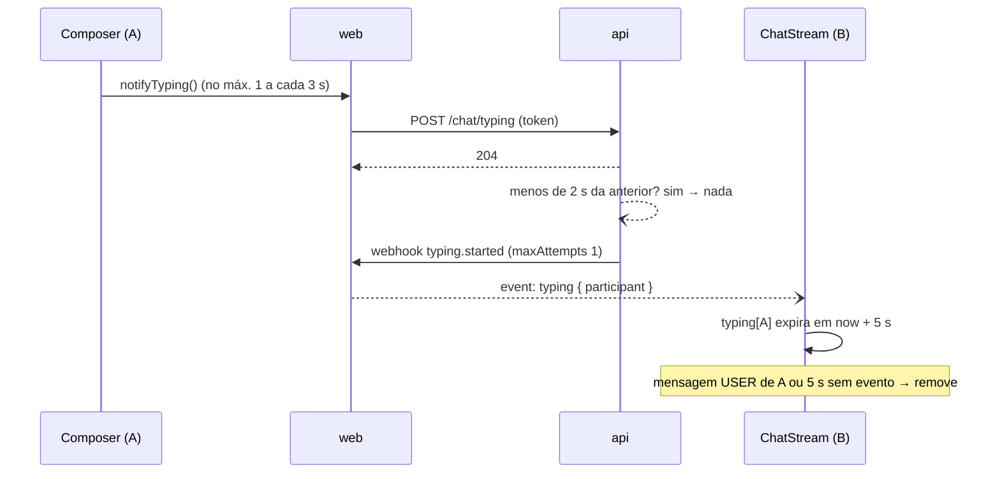

# Extras: digitando e mensagens anteriores (F4) Design

**Spec**: `.specs/features/chat-extras/spec.md`
**Status**: Draft

---

## Architecture Overview

Duas funções independentes, ambas sobre a estrutura da F2/F3:

- **Digitando** percorre o mesmo caminho das mensagens, com um terceiro tipo de evento: `Composer` → action `notifyTyping` → `POST /chat/typing` → `typing.started` (1 tentativa) → receptor → hub → `event: typing` → reducer → `TypingIndicator`.
- **Mensagens anteriores** é uma leitura por Server Action com o cursor `before`, inserida no topo do estado sem mexer na posição de leitura.



---

## Code Reuse Analysis

### Existing Components to Leverage

| Component                                                       | Location                                   | How to Use                                                             |
| --------------------------------------------------------------- | ------------------------------------------ | ---------------------------------------------------------------------- |
| `WebhookDispatcher.dispatch(type, data, { maxAttempts })`       | `modules/webhooks/` (F2)                   | `typing.started` com `maxAttempts: 1` (TYPE-01 AC5); a opção já existe |
| `ParticipantTokenGuard`, `@CurrentParticipant()`                | `modules/chat/` (F1)                       | Protege `POST /chat/typing`                                            |
| `@SkipThrottle()` nos controllers do chat                       | AD-004                                     | Vale para o novo controller                                            |
| `handleChatWebhook`, `webhookEnvelopeSchema`, `ChatHub.publish` | `features/chat/realtime/`, `schemas/` (F2) | Ganham o tipo `typing.started`                                         |
| `chatRoomReducer`, `useChatEvents`                              | `features/chat/state/` (F2/F3)             | Novas ações `typing/*` e `history/*`; novo handler `onTyping`          |
| `getMessages({ before, limit })`                                | `features/chat/queries/` (F1)              | Busca das anteriores                                                   |
| `TypingIndicator`                                               | `features/chat/components/` (F0)           | Recebe `names` do estado                                               |
| `MessageList.client` + `useStickToBottom`                       | F0/F3                                      | Ganha o botão do topo e a compensação de rolagem                       |
| `SendRateLimiter` (padrão)                                      | `modules/chat/services/` (F3)              | `TypingThrottle` segue o mesmo formato (relógio por parâmetro)         |

### Integration Points

| System   | Integration Method                                             |
| -------- | -------------------------------------------------------------- |
| Contrato | `POST /api/v1/chat/typing` no Swagger → `@repo/api-client`     |
| Webhook  | Novo tipo `typing.started` no envelope (api e zod do web)      |
| SSE      | Novo evento `typing`, sem `id:` (não entra no `Last-Event-ID`) |

---

## Components (api)

### `TypingController`

- **Location**: `modules/chat/controllers/typing.controller.ts`
- **Interfaces**: `@Controller('chat/typing')`, `@SkipThrottle()`; `POST /` `@UseGuards(ParticipantTokenGuard)` `@HttpCode(204)` `notify(@CurrentParticipant() actor): void` → `204`; `401`
- **Dependencies**: `TypingService`

### `TypingService`

- **Purpose**: Disparar `typing.started` com limite de 2 s por participante (TYPE-01 AC2, AC4).
- **Location**: `modules/chat/services/typing.service.ts`
- **Interfaces**:
  - `notify(actor: Participant, nowMs = Date.now()): void` — se a última notificação aceita do participante foi há menos de 2 s, retorna sem fazer nada; senão grava `nowMs` e `dispatch('typing.started', { participant: { id, name } }, { maxAttempts: 1 })`
  - `TYPING_MIN_INTERVAL_MS = 2_000`
- O mapa remove entradas com mais de 2 s quando é consultado, para não crescer sem limite.

---

## Components (web)

### Action `notifyTyping`

- **Location**: `features/chat/actions/notify-typing.ts`
- **Interfaces**: `notifyTyping(): Promise<void>` — lê a sessão; sem sessão, não faz nada; chama `POST /chat/typing`; ignora qualquer erro (o aviso é descartável)
- Sem `refresh()` e sem redirect: um `401` aqui não deve tirar a pessoa da sala no meio da digitação; o próximo envio cuida disso.

### `Composer` (extensão)

- Nova prop `onTyping?: () => void`
- No `onChange` com conteúdo não vazio: chama `onTyping` se a última chamada foi há 3 s ou mais (`useRef` com o instante; sem timer) (TYPE-01 AC1)

### Receptor e hub (extensão)

- `webhookEnvelopeSchema` ganha `{ type: 'typing.started', data: { participant: { id: uuid, name } } }`
- `HubEvent` ganha o mesmo tipo; `publish` escreve `event: typing` sem `id:` (TYPE-02 AC6)
- No buffer de recuperação da F3, eventos `typing` são descartados (expiram em 5 s de qualquer forma)

### Estado (extensão do `chatRoomReducer`)

- `ChatRoomState` ganha:
  - `typing: Record<participantId, { name: string; expiresAt: number }>`
  - `history: { hasMore: boolean; status: 'idle' | 'loading' | 'error' }`
- Ações:
  - `typing/started { participant, now }` — ignora o próprio `me.id` (TYPE-02 AC7); `expiresAt = now + 5_000` (AC8)
  - `typing/expired { now }` — remove quem tem `expiresAt ≤ now`
  - `message/received` remove do `typing` o autor de uma mensagem `USER` (AC9)
  - `history/requested`, `history/loaded { items }`, `history/failed`
  - `history/loaded` insere os itens no início, ignora `seq` já presente (HIST-01 AC7) e define `hasMore = items.length === 50` (AC5)
- Estado inicial: `hasMore = initialMessages.length === 50` (HIST-01 AC1)
- Seletor `selectTypingNames(state): string[]` (ordem de chegada)

### `ChatStream.client` (extensão)

- `useChatEvents` ganha `onTyping(participant)` → `typing/started` com `Date.now()`
- Expiração: um único `setTimeout` agendado para o próximo `expiresAt` (refeito quando `typing` muda), que despacha `typing/expired`. Não é polling: só existe enquanto há alguém digitando, e não busca dados.
- `loadOlder()`: `history/requested` → `actions.loadOlder(menorSeq)` → `history/loaded` ou `history/failed`
- Passa `actions.typing` ao `Composer` como `onTyping`

### Action `loadOlderMessages`

- **Location**: `features/chat/actions/load-older-messages.ts`
- **Interfaces**: `loadOlderMessages(before: number): Promise<{ ok: true; items: ChatMessage[] } | { ok: false }>` — valida `before` (inteiro positivo, zod); sem sessão válida → `{ ok: false }`; `getMessages({ before, limit: 50 })` (HIST-01 AC2)
- Leitura via Server Action é a exceção aqui: o navegador não pode chamar a api, e a busca é disparada por clique depois do SSR.

### `MessageList.client` (extensão)

- Novas props: `history?: { hasMore: boolean; status: 'idle' | 'loading' | 'error'; onLoad(): void }`
- No topo, com `hasMore`: botão "Carregar mensagens anteriores"; `loading` → desabilitado com "Carregando…" (HIST-01 AC4); `error` → botão de volta + erro do dicionário (AC6)
- Compensação de rolagem (AC3): antes de pedir, guarda `scrollHeight`; num `useLayoutEffect` disparado pela mudança do primeiro `seq`, soma a diferença ao `scrollTop`. O `useStickToBottom` ignora essa mudança (não é mensagem nova no fim).

### `TypingIndicator`

Sem mudança de interface. Os textos de 1, 2 e 3+ nomes já estão no dicionário desde a F0 (TYPE-02 AC10-11). Fica entre a lista e o `Composer`, com `aria-live="polite"`.

---

## Data Models

Sem tabela nova. `typing.started` vai para `webhook_deliveries` com uma tentativa só (premissa da spec).

```typescript
interface TypingStartedData {
  participant: { id: string; name: string };
}
```

---

## Error Handling Strategy

| Error Scenario                    | Handling                                        | User Impact                        |
| --------------------------------- | ----------------------------------------------- | ---------------------------------- |
| `POST /typing` com token inválido | api `401`; action ignora                        | Nenhum                             |
| Webhook `typing.started` falha    | Uma tentativa, `FAILED`                         | O aviso não aparece desta vez      |
| Quem digitava sai da sala         | Expira em até 5 s                               | Aviso some sozinho                 |
| Busca de anteriores falha         | `history/failed`                                | Erro do dicionário; botão continua |
| Mensagens ao vivo durante a busca | O reducer insere por `seq` e ignora repetidas   | Lista em ordem, sem duplicar       |
| Sala com exatamente 50 mensagens  | Botão aparece; clique traz 0; `hasMore = false` | Botão some                         |

---

## Risks & Concerns

| Concern                                                 | Location (file:line)      | Impact                             | Mitigation                                                               |
| ------------------------------------------------------- | ------------------------- | ---------------------------------- | ------------------------------------------------------------------------ |
| Cada tecla vira chamada de Server Action                | `composer.client.tsx`     | Tráfego alto entre navegador e web | Limite de 3 s no `Composer` + 2 s na api                                 |
| Compensação de rolagem com imagens ou fontes carregando | `message-list.client.tsx` | Lista "pula" um pouco              | Só texto no chat; `useLayoutEffect` antes da pintura                     |
| `typing.started` enche `webhook_deliveries`             | api                       | Tabela cresce rápido               | Sem expiração nesta versão (premissa); anotar como evolução              |
| Limite de 2 s em memória                                | `typing.service.ts`       | Zera ao reiniciar a api            | Irrelevante para um aviso de 5 s                                         |
| `setTimeout` de expiração confundido com polling        | `chat-stream.client.tsx`  | Leitura apressada de SSE-03 AC13   | Comentário de uma linha: o timer só expira estado local, não busca dados |

---

## Tech Decisions

| Decision                     | Choice                                    | Rationale                                  |
| ---------------------------- | ----------------------------------------- | ------------------------------------------ |
| Limite do navegador          | Instante da última chamada em `useRef`    | Sem timers no `Composer`                   |
| Expiração do "digitando"     | Um `setTimeout` para o próximo vencimento | Um timer por sala, não por pessoa          |
| Anteriores via Server Action | `loadOlderMessages(before)`               | Regra "o navegador não chama a api"        |
| `hasMore`                    | Última página com 50 itens                | Premissa da spec; dispensa contagem na api |
| Evento `typing` sem `id:`    | Fora do `Last-Event-ID`                   | Não pode mover o cursor de recuperação     |
