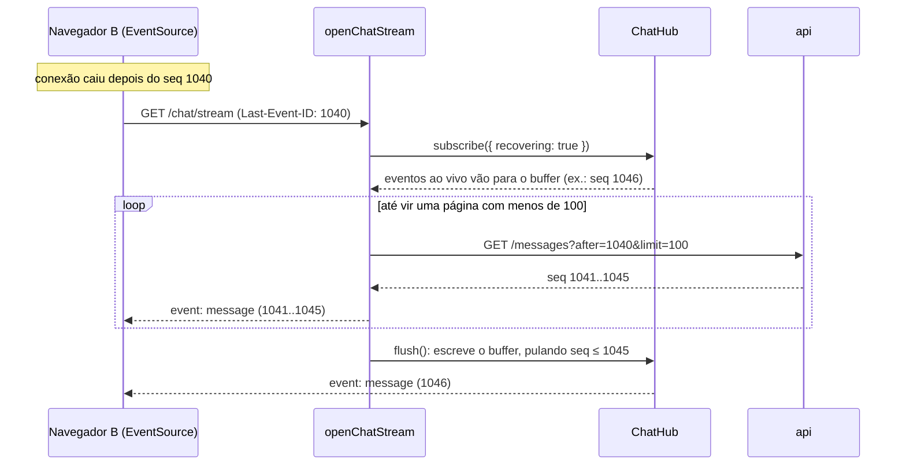
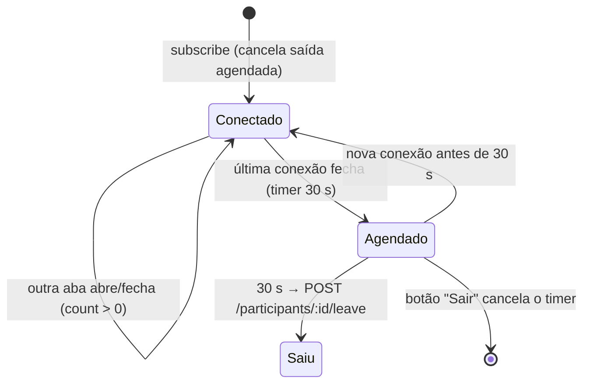

# Robustez do chat em tempo real (F3) Design

**Spec**: `.specs/features/chat-resilience/spec.md`
**Status**: Draft

---

## Architecture Overview

A F3 não cria camadas novas. Ela estende quatro peças da F2:

| Peça                                          | O que ganha                                                                           | Requisitos                |
| --------------------------------------------- | ------------------------------------------------------------------------------------- | ------------------------- |
| `openChatStream` + `ChatHub` (web)            | Recuperação por `Last-Event-ID` com buffer; saída agendada 30 s após a última conexão | RECON-01, AWAY-01         |
| `chatRoomReducer` + `ChatStream.client` (web) | Mensagem otimista, estado da conexão, falha e "Tentar de novo"                        | OPT-01, RECON-02, RATE-02 |
| `MessageList.client` (web)                    | Rolagem que respeita a leitura e "Novas mensagens ↓"                                  | SCROLL-01                 |
| `MessagesService` (api)                       | Idempotência por `clientId` e limite de 5 mensagens em 10 s                           | OPT-02, RATE-01           |





---

## Code Reuse Analysis

### Existing Components to Leverage

| Component                                                | Location                              | How to Use                                                                 |
| -------------------------------------------------------- | ------------------------------------- | -------------------------------------------------------------------------- |
| `ChatHub`, `openChatStream`, `formatSseEvent`            | `features/chat/realtime/` (F2)        | Estendidos; a interface de `subscribe` ganha opções                        |
| `getMessages({ after, limit })`                          | `features/chat/queries/` (F1)         | Busca das mensagens perdidas                                               |
| Chamada `POST /participants/:id/leave` da action `leave` | `features/chat/actions/leave.ts` (F1) | Extraída para `leaveParticipant()`, usada pela action e pelo hub           |
| `chatRoomReducer`, `useChatEvents`                       | `features/chat/state/` (F2)           | Novas ações e o callback de status da conexão                              |
| `MessageBubble` (`status`, `onRetry`)                    | `features/chat/components/` (F0)      | Estados "enviando" e "Não enviada · Tentar de novo" já previstos nas props |
| `Composer` (`notice`, `error`)                           | `features/chat/components/` (F0)      | "Reconectando…" e aviso de limite                                          |
| `MessagesService.send`, `IMessageRepository`             | `apps/api/src/modules/chat/` (F1)     | Idempotência e limite antes de gravar                                      |

### Integration Points

| System              | Integration Method                                                   |
| ------------------- | -------------------------------------------------------------------- |
| Banco               | Migration com `@@unique([participantId, clientId])` em `messages`    |
| Swagger             | `POST /chat/messages` documenta `429` e o header `Retry-After`       |
| Server Action ↔ hub | `leave` chama `getChatHub().cancelAway(participantId)` antes de sair |

---

## Components (web)

### `ChatHub` (extensão)

- **Purpose**: Recuperação com buffer e saída por desconexão.
- **Location**: `features/chat/realtime/chat-hub.ts`
- **Interfaces**:
  - `new ChatHub({ awayDelayMs = 30_000, onAway: (participant: { id: string; token: string }) => Promise<void> })`; `getChatHub()` cria com `onAway: leaveParticipant`
  - `subscribe(conn: HubConnection, options?: { recovering?: boolean }): Subscription`
  - `interface Subscription { unsubscribe(): void; flush(lastSeqWritten: number): void }` — com `recovering`, os eventos ao vivo vão para um buffer da conexão até o `flush`; o `flush` escreve o buffer na ordem, pulando `message` com `seq ≤ lastSeqWritten` (RECON-01 AC2)
  - `subscribe` cancela a saída agendada do participante (AWAY-01 AC2)
  - `unsubscribe` da última conexão do participante agenda `onAway` para `awayDelayMs` (AC1, AC4)
  - `cancelAway(participantId: string): void` (AC5)
  - `onAway` rejeitado → log `warn`, sem propagar (AC6)
- **Testes**: `vi.useFakeTimers()`: fechar a única conexão, avançar 29 s (nenhuma chamada), avançar 1 s (uma chamada); reabrir antes cancela; duas abas e fechar uma não agenda.

### `leaveParticipant`

- **Purpose**: Uma chamada de saída usada pela action `leave` e pelo `onAway`.
- **Location**: `features/chat/session/leave-participant.ts` (server-only). Não fica em `actions/`: todo export de um arquivo `'use server'` vira endpoint público; nem em `queries/`, que é só leitura.
- **Interfaces**: `leaveParticipant(p: { id: string; token: string }): Promise<'left' | 'gone' | 'error'>` — `204` → `left`; `401`/`404` → `gone` (AC6); outros → `error`

### `openChatStream` (extensão)

- **Interfaces**: além da F2:
  - `parseLastEventId(header: string | null): number | null` — inteiro positivo ou `null` (RECON-01 AC3)
  - Com `lastEventId`: `subscribe(conn, { recovering: true })` **antes** de buscar (premissa da spec); `recoverMissed(after)` pagina `getMessages({ after, limit: 100 })` até vir menos de 100 e escreve cada uma com `id: seq`; depois `flush(último seq escrito)`
  - Falha na busca → `unsubscribe()` + `controller.error()`; o `EventSource` reconecta com o mesmo `Last-Event-ID` (AC4)

### `chatRoomReducer` (extensão)

- **Interfaces**:
  - `type ChatItem = { kind: 'confirmed'; message: ChatMessage } | { kind: 'pending'; clientId: string; content: string; createdAt: string; status: 'sending' | 'failed' }`
  - `ChatRoomState` ganha `pending: PendingMessage[]` (sempre renderizadas depois das confirmadas, OPT-01 AC1) e `connection: 'open' | 'reconnecting'`
  - Novas ações:
    - `message/optimistic { clientId, content, createdAt }`
    - `message/confirmed { message }` — resposta da action (AC3)
    - `message/failed { clientId }` (AC4)
    - `message/retry { clientId }` — volta para `sending` (AC5)
    - `connection/changed { status }` (RECON-02)
  - `message/received` e `message/confirmed` removem a `pending` com o mesmo `clientId` e inserem pela posição de `seq`, ignorando `seq` repetido (AC2; edge case "SSE chega antes da action")
  - Seletor `selectItems(state): ChatItem[]`

### `ChatStream.client` (extensão)

- `send(content)`: gera `clientId`, `dispatch(message/optimistic)`, chama `actions.send({ content, clientId })` em `startTransition`; `ok` → `message/confirmed`; `rate_limited` → `message/failed` + aviso de limite no `Composer` (RATE-02); outros → `message/failed`
- `retry(clientId)`: `message/retry` e reenvio com o mesmo `clientId` e conteúdo
- `useChatEvents` ganha `onStatus(status)`: `error` → `reconnecting`; `open` → `open`; o `Composer` recebe `notice={t.reconnecting}` (RECON-02 AC5-6)
- Pede ao `MessageList` para rolar até o fim ao enviar (SCROLL-01 AC5)

### Rolagem (`MessageList.client` + `use-stick-to-bottom.ts`)

- **Location**: `features/chat/components/message-list.client.tsx`, `features/chat/state/use-stick-to-bottom.ts`
- **Interfaces**:
  - `useStickToBottom(ref: RefObject<HTMLElement>, deps: { count: number; forceKey: number }): { showNewBelow: boolean; scrollToBottom(): void }`
  - "No fim" = `scrollHeight − scrollTop − clientHeight ≤ 80` (premissa da spec)
  - Ao mudar `count`: se estava no fim, rola; senão `showNewBelow = true` (SCROLL-01 AC1-2)
  - `scroll` até o fim esconde o botão (AC4); `forceKey` muda ao enviar e força a rolagem (AC5)
  - `MessageList` mostra "Novas mensagens ↓" (`Button`) quando `showNewBelow` (AC3)
- **Testes**: jsdom com `scrollHeight`/`clientHeight` definidos via `Object.defineProperty`; story com `play` no Chromium (rolar, injetar, clicar)

### Action `sendMessage` (extensão)

- `429` → `{ ok: false, reason: 'rate_limited', retryAfter: number }` (lê `Retry-After`)
- Sem `refresh()` (já removido na F2; OPT-01 AC7)

### Action `leave` (extensão)

- `getChatHub().cancelAway(session.participantId)` antes de chamar `leaveParticipant` (AWAY-01 AC5)

---

## Components (api)

### `SendRateLimiter`

- **Purpose**: Janela deslizante de 10 s por participante, em memória (RATE-01).
- **Location**: `modules/chat/services/send-rate-limiter.ts`
- **Interfaces**:
  - `tryAcquire(participantId: string, nowMs: number): { ok: true } | { ok: false; retryAfterSeconds: number }` — guarda os instantes dos últimos envios; descarta os mais velhos que 10 s; com 5 na janela recusa, `retryAfterSeconds = ceil((maisAntigo + 10_000 − now) / 1000)`
  - Limite e janela como constantes (`SEND_LIMIT = 5`, `SEND_WINDOW_MS = 10_000`)
- `@Injectable()` singleton no `ChatModule`. O relógio vem por parâmetro (testes sem fake timers).

### `MessagesService.send` (extensão)

Ordem (OPT-02, RATE-01 AC3):

1. `clientId` presente → `repo.findByClientId(actor.id, clientId)` → achou → devolve `201` com a existente, **sem** limite e **sem** webhook
2. `rateLimiter.tryAcquire(actor.id, Date.now())` → recusado → `throw new RateLimitedException(retryAfterSeconds)`
3. `repo.create(...)`; `P2002` em `(participant_id, client_id)` (corrida entre dois reenvios) → `findByClientId` e devolve a existente, sem webhook
4. `dispatch('message.created', dto)`

### `RateLimitedException` + filtro

- `RateLimitedException extends HttpException` (`429`, mensagem do dicionário da api) com `retryAfterSeconds`
- `RateLimitedExceptionFilter` (`@UseFilters` no `MessagesController`) grava `Retry-After` e o corpo padrão
- Swagger: `@ApiTooManyRequestsResponse({ headers: { 'Retry-After': { schema: { type: 'integer' } } } })`

### Repositório

- `IMessageRepository.findByClientId(participantId: string, clientId: string): Promise<MessageWithAuthor | null>`

---

## Data Models

```prisma
model Message {
  // ... campos da F1
  @@unique([participantId, clientId], map: "messages_participant_client_key")
}
```

No Postgres, `NULL` não conflita em índice único, então mensagens de sistema e envios sem `clientId` continuam livres.

---

## Error Handling Strategy

| Error Scenario                    | Handling                                                                           | User Impact                                                            |
| --------------------------------- | ---------------------------------------------------------------------------------- | ---------------------------------------------------------------------- |
| Busca das perdidas falha          | Fecha o stream com erro; o `EventSource` tenta de novo com o mesmo `Last-Event-ID` | "Reconectando…" até conseguir                                          |
| `Last-Event-ID` inválido          | Ignorado; stream normal                                                            | —                                                                      |
| Action falha (rede, 5xx)          | `message/failed`                                                                   | "Não enviada · Tentar de novo"                                         |
| `429`                             | `message/failed` + aviso no `Composer`                                             | "Você está enviando mensagens rápido demais. Aguarde alguns segundos." |
| Retry de mensagem já gravada      | api devolve a existente; o reducer confirma pelo `clientId`                        | Uma mensagem só                                                        |
| Saída agendada recebe `401`/`404` | `gone`, descartado                                                                 | —                                                                      |
| Web reinicia com saídas agendadas | Timers perdidos (AD-003); a pessoa fica online até sair ou o próximo stream fechar | Contador pode ficar alto; limitação aceita no PRD §12                  |

---

## Risks & Concerns

| Concern                                          | Location (file:line)          | Impact                                                           | Mitigation                                                                                                           |
| ------------------------------------------------ | ----------------------------- | ---------------------------------------------------------------- | -------------------------------------------------------------------------------------------------------------------- |
| Ordem entre o `subscribe` e a busca das perdidas | `open-chat-stream.ts`         | Evento chegado durante a busca seria perdido ou duplicado        | `subscribe({ recovering })` antes da busca + `flush(lastSeq)` que pula `seq` já escrito; teste do hub cobre o buffer |
| `flush` entrega eventos `presence` antigos       | `chat-hub.ts`                 | Contador volta a um valor velho por um instante                  | O buffer guarda só o último `presence` (descarta os anteriores)                                                      |
| Limite em memória da api                         | `send-rate-limiter.ts`        | Reiniciar a api zera as janelas; não vale para várias instâncias | Fora de escopo na spec (uma instância)                                                                               |
| Mapa do limiter cresce com participantes         | `send-rate-limiter.ts`        | Memória cresce com o tempo                                       | Remover a chave quando a janela fica vazia                                                                           |
| `setOffline` do Playwright e `EventSource`       | `e2e/chat-resilience.spec.ts` | Teste instável se o navegador não derrubar o stream na hora      | Esperar o "Reconectando…" visível antes de A enviar; só então voltar a rede                                          |
| E2E da saída por desconexão leva 30 s            | `e2e/`                        | E2E mais lento                                                   | Um teste só, com timeout de 45 s                                                                                     |
| `useStickToBottom` depende de medidas de layout  | `use-stick-to-bottom.ts`      | jsdom não calcula layout                                         | Medidas definidas no teste; comportamento real na story com `play`                                                   |

---

## Tech Decisions

| Decision                     | Choice                                       | Rationale                                                                    |
| ---------------------------- | -------------------------------------------- | ---------------------------------------------------------------------------- |
| Onde fica a otimista         | Lista `pending` separada, renderizada no fim | Ainda não tem `seq`; a confirmação a move para a posição certa               |
| Idempotência antes do limite | `findByClientId` primeiro                    | Um retry não pode gastar o limite (RATE-01 AC3)                              |
| `Retry-After`                | Filtro do módulo para a exceção própria      | Controller e service ficam sem `@Res`                                        |
| Relógio do limiter           | `nowMs` por parâmetro                        | Testes determinísticos sem fake timers                                       |
| Saída por desconexão         | Callback `onAway` injetado no hub            | Hub testável sem rede; a chamada real fica em `session/leave-participant.ts` |
| Buffer de `presence`         | Só o último valor                            | É estado, não histórico                                                      |
