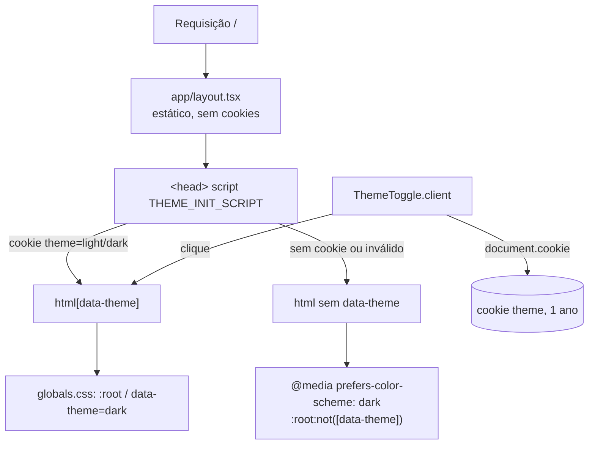

# Tema e componentes visuais do chat (F0) Design

**Spec**: `.specs/features/chat-theme/spec.md`
**Status**: Draft

---

## Architecture Overview

A F0 é só web. Três blocos independentes:

1. **Tokens**: as cores da coleção Tema do FigCraft viram variáveis CSS em `globals.css`, nos três seletores de tema, e são ligadas ao Tailwind e às variáveis do shadcn.
2. **Tema sem piscar** (AD-001): o root layout não lê cookies. Um script inline no `<head>` lê o cookie `theme` e grava `data-theme` no `<html>` antes da primeira pintura. Sem cookie, o CSS segue `prefers-color-scheme`.
3. **Componentes da Sala e da tela Entrar**: síncronos, só com props, com stories nos dois temas e nas três faixas.

Como os tokens estão em variáveis CSS e os seletores aceitam qualquer elemento (`[data-theme='dark']`), um `
` também troca o tema do que está dentro. O Storybook usa isso.

---

## Code Reuse Analysis

### Existing Components to Leverage

| Component               | Location                                               | How to Use                                                                          |
| ----------------------- | ------------------------------------------------------ | ----------------------------------------------------------------------------------- |
| `Button`                | `apps/web/src/components/ui/button.tsx`                | Botões "Entrar no chat", "Enviar", "Sair" e o próprio `ThemeToggle` (`size="icon"`) |
| `Input`, `Label`        | `apps/web/src/components/ui/input.tsx`, `label.tsx`    | Campo "Seu nome" e campo de mensagem                                                |
| `cn()`                  | `apps/web/src/lib/utils.ts`                            | Composição de classes                                                               |
| `lucide-react`          | dependência já instalada                               | Ícones `Moon`, `Sun`, `Send`, `LogOut`, `MessagesSquare`                            |
| Padrão `ExampleForm`    | `features/examples/components/example-form.client.tsx` | `useActionState` com a action por props, erros com `aria-describedby`               |
| Padrão de stories       | `features/examples/components/*.stories.tsx`           | Uma story por estado, `fn()` para actions                                           |
| `check-conventions.mjs` | `apps/web/scripts/check-conventions.mjs`               | Ganha a checagem de cor literal (THEME-01 AC2)                                      |

### Integration Points

| System                     | Integration Method                                                                                                                           |
| -------------------------- | -------------------------------------------------------------------------------------------------------------------------------------------- |
| shadcn (`Button`, `Input`) | As variáveis do shadcn (`--background`, `--primary`, `--ring`…) passam a apontar para os tokens do design                                    |
| Tailwind v4                | `@theme inline` expõe os tokens como cores (`bg-page`, `text-fg-secondary`…); `@custom-variant dark` passa a seguir `data-theme` e o sistema |
| Storybook                  | `preview.ts` ganha o global `theme`, um decorator que aplica `data-theme` e as viewports `mobile`/`tablet`/`desktop`                         |
| Vitest (storybook)         | Um segundo project, `storybook-dark`, roda todas as stories no tema escuro                                                                   |

---

## Components

### Tokens (`globals.css`)

- **Purpose**: Definir os 15 tokens do PRD §8.2 e os 4 de avatar, ligados ao Tailwind e ao shadcn.
- **Location**: `apps/web/src/app/globals.css`
- **Interfaces**:
  - Variáveis: `--bg-page`, `--bg-surface`, `--bg-subtle`, `--border-default`, `--text-primary`, `--text-secondary`, `--text-muted`, `--text-button`, `--brand-default`, `--brand-soft`, `--brand-text`, `--brand-ring`, `--text-on-brand`, `--status-online`, `--shadow-card`, `--avatar-pink-bg`, `--avatar-pink-fg`, `--avatar-green-bg`, `--avatar-green-fg`
  - Três blocos: `:root` (Light), `[data-theme='dark']` (Dark) e `@media (prefers-color-scheme: dark) { :root:not([data-theme]) { … } }` (Dark)
  - Cores do Tailwind em `@theme inline`: `page`, `surface`, `subtle`, `line`, `fg`, `fg-secondary`, `fg-muted`, `fg-button`, `brand`, `brand-soft`, `brand-text`, `brand-ring`, `on-brand`, `online`, `avatar-pink-bg`, `avatar-pink-fg`, `avatar-green-bg`, `avatar-green-fg`; sombra `shadow-card`
  - Variáveis do shadcn redefinidas a partir dos tokens: `--background: var(--bg-page)`, `--foreground: var(--text-primary)`, `--card: var(--bg-surface)`, `--primary: var(--brand-default)`, `--primary-foreground: var(--text-on-brand)`, `--muted-foreground: var(--text-secondary)`, `--border`/`--input: var(--border-default)`, `--ring: var(--brand-default)`. O bloco `.dark` atual sai.
  - `@custom-variant dark` passa a casar `[data-theme='dark']` e `:root:not([data-theme])` dentro de `@media (prefers-color-scheme: dark)`, para os `dark:` do shadcn seguirem o mesmo tema
- **Dependencies**: nenhuma
- **Reuses**: estrutura atual do `globals.css` (imports, `@layer base`, fontes do sistema)

### `lib/theme.ts`

- **Purpose**: Regras do cookie de tema num lugar só, usadas pelo script, pelo `ThemeToggle` e pelos testes.
- **Location**: `apps/web/src/lib/theme.ts`
- **Interfaces**:
  - `type Theme = 'light' | 'dark'`
  - `THEME_COOKIE = 'theme'`
  - `parseTheme(value: string | undefined): Theme | null` — qualquer valor fora de `light`/`dark` vira `null` (THEME-02 AC4)
  - `serializeThemeCookie(theme: Theme): string` — `theme=<v>; Path=/; Max-Age=31536000; SameSite=Lax` (THEME-03 AC8)
  - `THEME_INIT_SCRIPT: string` — IIFE com `try/catch`: lê `document.cookie`, aplica `data-theme` só para `light`/`dark`
  - `readEffectiveTheme(doc: Document, matchMedia: (q: string) => MediaQueryList): Theme` — `data-theme` se existir; senão o sistema
- **Dependencies**: nenhuma (roda no servidor e no navegador; sem `server-only`)
- **Reuses**: —

### Root layout

- **Purpose**: Aplicar o tema antes da pintura sem tornar o app dinâmico (AD-001).
- **Location**: `apps/web/src/app/layout.tsx`
- **Interfaces**: `<html lang="pt-BR" suppressHydrationWarning>` + `<head><script dangerouslySetInnerHTML={{ __html: THEME_INIT_SCRIPT }} /></head>`
- **Dependencies**: `lib/theme.ts`
- **Reuses**: layout atual. O script é uma constante; nenhum dado do usuário é interpolado.

### `ThemeToggle` (`components/ui/theme-toggle.client.tsx`)

- **Purpose**: Alternar o tema e gravar o cookie (THEME-03).
- **Location**: `apps/web/src/components/ui/theme-toggle.client.tsx`
- **Interfaces**: `ThemeToggle({ labels }: { labels: { toDark: string; toLight: string } })`
  - Renderiza os dois estados: lua + "Usar tema escuro" e sol + "Usar tema claro". O CSS mostra só o do tema efetivo (`dark:hidden` / `hidden dark:inline-flex`), então o HTML do servidor já é o certo, sem estado React e sem erro de hidratação.
  - `onClick`: `next = readEffectiveTheme() === 'dark' ? 'light' : 'dark'`; grava `data-theme` e `document.cookie = serializeThemeCookie(next)`.
  - `useLayoutEffect` reaplica o cookie no `<html>` (o Strict Mode de dev limpa o atributo no remount; em produção não muda nada).
- **Dependencies**: `lib/theme.ts`, `Button`, `lucide-react`
- **Reuses**: `Button` (`variant="ghost"`, `size="icon"`)
- Os rótulos chegam por props porque `components/ui` não importa dicionário de feature.

### `Avatar` (`components/ui/avatar.tsx`)

- **Purpose**: Inicial do nome com cor estável por participante (UI-01 AC4).
- **Location**: `apps/web/src/components/ui/avatar.tsx`
- **Interfaces**:
  - `Avatar({ name, colorSeed, tone = 'auto', size = 'md' }: { name: string; colorSeed: string; tone?: 'auto' | 'brand'; size?: 'sm' | 'md' })`
  - `initialOf(name: string): string` — primeiro grafema (`Intl.Segmenter`), `toLocaleUpperCase('pt-BR')`; "érica" → "É"
  - `pickAvatarTone(seed: string): AvatarTone` — FNV-1a 32 bits sobre o `seed`, módulo `AVATAR_TONES.length`
  - `AVATAR_TONES = ['pink', 'green'] as const` (os pares que existem no FigCraft)
  - `tone="brand"` usa `bg-brand text-on-brand` (avatar próprio)
- **Dependencies**: `cn()`
- **Reuses**: —

### `lib/format-time.ts`

- **Purpose**: Hora dos balões igual no servidor e no navegador.
- **Interfaces**: `formatTime(iso: string): string` — `Intl.DateTimeFormat('pt-BR', { hour: '2-digit', minute: '2-digit', timeZone: 'America/Sao_Paulo' })`
- **Location**: `apps/web/src/lib/format-time.ts`

### Componentes da feature `chat`

Todos em `apps/web/src/features/chat/components/`, cada um com spec e story ao lado. Textos vêm de `chat.dictionary.ts`.

| Componente        | Arquivo                   | Props (resumo)                                                                                             | Notas                                                                                                                                                                                       |
| ----------------- | ------------------------- | ---------------------------------------------------------------------------------------------------------- | ------------------------------------------------------------------------------------------------------------------------------------------------------------------------------------------- |
| `JoinForm`        | `join-form.client.tsx`    | `action: JoinAction`                                                                                       | Cartão completo da tela Entrar (logo, título, subtítulo, campo, botão, ajuda). `useActionState`; mostra erro do campo. `w-full md:w-[420px]`                                                |
| `ChatHeader`      | `chat-header.tsx`         | `me: { id; name }`, `online: number`, `leaveAction: () => Promise<void>`                                   | "Sala geral", `OnlineBadge`, `Avatar tone="brand"`, nome (`hidden md:inline`), `ThemeToggle`, `<form action={leaveAction}>` com "Sair"                                                      |
| `OnlineBadge`     | `online-badge.tsx`        | `count: number`                                                                                            | Ponto `bg-online` + `t.online(count)`: "1 pessoa online" / "N pessoas online"                                                                                                               |
| `MessageList`     | `message-list.client.tsx` | `messages: ChatMessage[]`, `meId: string`, `footer?: ReactNode`                                            | `<ol aria-live="polite">`; vazio → `t.room.empty`; escolhe `MessageBubble` ou `SystemMessage` pelo `type`. Cliente porque rola até o fim (F1) e ganha rolagem inteligente (F3)              |
| `MessageBubble`   | `message-bubble.tsx`      | `message: ChatMessage`, `own: boolean`, `status?: 'sent' \| 'sending' \| 'failed'`, `onRetry?: () => void` | Outros: esquerda, avatar, nome, hora, `bg-surface`. Próprio: direita, "Você", `bg-brand text-on-brand`. Conteúdo em `{text}` com `whitespace-pre-wrap break-words [overflow-wrap:anywhere]` |
| `SystemMessage`   | `system-message.tsx`      | `text: string`                                                                                             | Centralizado, `text-fg-muted`, `text-sm`                                                                                                                                                    |
| `Composer`        | `composer.client.tsx`     | `onSend: (content: string) => void`, `pending?`, `error?: string`, `notice?: string`                       | Textarea "Escreva uma mensagem…" + "Enviar". F0: só visual e `onSend`; o Enter/Shift+Enter entra na F1                                                                                      |
| `TypingIndicator` | `typing-indicator.tsx`    | `names: string[]`                                                                                          | `t.typing(names)`; vazio → não renderiza                                                                                                                                                    |
| `ChatRoomView`    | `chat-room-view.tsx`      | `header: ReactNode`, `list: ReactNode`, `composer: ReactNode`                                              | Layout da Sala: `h-dvh flex flex-col`; cabeçalho e composer fixos; só a lista rola; coluna `xl:max-w-[800px] xl:mx-auto` (UI-02)                                                            |

Os breakpoints padrão do Tailwind batem com o PRD: `md` = 768 px e `xl` = 1280 px.

### Tipos e textos

- `chat.types.ts`: na F0, `ChatMessage` e `ChatParticipant` são declarados à mão, no formato do `MessageResponseDto` do PRD §6.1, porque a api ainda não tem o contrato. A F1 troca por `Schemas['MessageResponseDto']`; o typecheck acusa qualquer diferença.
- `chat.dictionary.ts`: textos das telas, `online(count)`, `typing(names)`, `system.joined(name)`, `system.left(name)`, rótulos do `ThemeToggle`, erros.
- `test-fixtures.ts`: `makeMessage(overrides)`, `makeParticipant(overrides)`, `makeConversation()` (as mensagens dos frames: Ana, Carlos, Você e sistema).

### Storybook

- **Location**: `apps/web/.storybook/preview.ts`, `apps/web/vitest.config.ts`
- **Interfaces**:
  - `globalTypes.theme` (`light` | `dark`) no toolbar; `initialGlobals.theme = import.meta.env.VITE_STORYBOOK_THEME ?? 'light'`
  - Decorator: aplica `document.documentElement.dataset.theme = globals.theme` e fundo `bg-page`
  - `parameters.viewport.options`: `mobile` (390×844), `tablet` (768×1024), `desktop` (1440×900)
  - Vitest: project `storybook-dark`, igual ao `storybook` mais `define: { 'import.meta.env.VITE_STORYBOOK_THEME': '"dark"' }`. `test:storybook` roda os dois projects, então toda story passa no a11y nos dois temas sem duplicar story (UI-04 AC15).
- **Stories das telas** (UI-04 AC14 e os 12 frames): `join-form.client.stories.tsx` e `chat-room-view.stories.tsx` exportam uma story por combinação `Tela · Faixa · Tema`, com `globals: { theme, viewport }` na story.
- **Stories de estado** (UI-04 AC13): `MessageList` (vazia, longa, próprias e dos outros, sistema), `TypingIndicator` (1, 2, 3+), `Composer` (erro de envio), `JoinForm` (nome em uso, via `action: fn()` que devolve o estado de erro).

### Checagem de cor literal

- **Purpose**: Garantir THEME-01 AC2 de forma determinística.
- **Location**: `apps/web/scripts/check-conventions.mjs`
- **Interfaces**: para arquivos em `src/features/chat/**` e `src/components/ui/{avatar,theme-toggle}*`, falha com hex (`#[0-9a-fA-F]{3,8}`), `rgb(`/`hsl(`/`oklch(` e classes de paleta do Tailwind (`(bg|text|border|ring|fill|stroke|from|to)-(slate|gray|zinc|neutral|stone|red|orange|amber|yellow|lime|green|emerald|teal|cyan|sky|blue|indigo|violet|purple|fuchsia|pink|rose)-\d{2,3}`)

---

## Data Models

Nenhum modelo persistido. O cookie `theme` guarda `light` ou `dark`.

### Valores dos tokens

Os 15 tokens seguem o PRD §8.2, com **4 valores ajustados para AA** (decisão desta fase). O PRD e o FigCraft precisam ser atualizados com eles.

| Token            | Light (FigCraft → novo)   | Dark (FigCraft → novo)    | Motivo                                                   |
| ---------------- | ------------------------- | ------------------------- | -------------------------------------------------------- |
| `text/secondary` | `#6B7280` → **`#687080`** | `#9CA3AF` (igual)         | 4.47:1 sobre `bg/page` → 4.60:1                          |
| `text/muted`     | `#9CA3AF` → **`#68707F`** | `#6B7280` → **`#7C8597`** | 2.35:1 e 3.92:1 → 4.61:1 e 5.10:1 (mensagens de sistema) |
| `brand/default`  | `#4F46E5` (igual)         | `#6366F1` → **`#5B5EF0`** | texto branco no balão próprio: 4.47:1 → 4.88:1           |

Pares de avatar do FigCraft (sem ajuste; todos acima de 4.5:1):

| Token             | Light     | Dark      |
| ----------------- | --------- | --------- |
| `avatar/pink-bg`  | `#FCE7F3` | `#500724` |
| `avatar/pink-fg`  | `#BE185D` | `#F9A8D4` |
| `avatar/green-bg` | `#DCFCE7` | `#052E16` |
| `avatar/green-fg` | `#15803D` | `#86EFAC` |

---

## Error Handling Strategy

| Error Scenario                              | Handling                                                      | User Impact                 |
| ------------------------------------------- | ------------------------------------------------------------- | --------------------------- |
| Cookie `theme` com valor desconhecido       | Script e `parseTheme` ignoram; vale o sistema                 | Tema do sistema, sem erro   |
| `document.cookie` indisponível (bloqueado)  | `try/catch` no script; o clique ainda troca o `data-theme`    | Tema muda, mas não persiste |
| `Intl.Segmenter` ausente (navegador antigo) | Não tratado: todos os navegadores suportados pelo Next 16 têm | —                           |

---

## Risks & Concerns

| Concern                                                                            | Location (file:line)                    | Impact                                                                                                      | Mitigation                                                                                                                                              |
| ---------------------------------------------------------------------------------- | --------------------------------------- | ----------------------------------------------------------------------------------------------------------- | ------------------------------------------------------------------------------------------------------------------------------------------------------- |
| Valores exatos do FigCraft reprovam no AA (4 combinações)                          | PRD §8.2                                | Stories quebram no a11y; RNF-07 falha                                                                       | 4 valores ajustados (tabela acima). Atualizar PRD §8.2; sincronizar o FigCraft                                                                          |
| `.dark` e `@custom-variant dark (&:is(.dark *))` do shadcn não seguem `data-theme` | `apps/web/src/app/globals.css:5`, `:95` | Classes `dark:` dos componentes shadcn ficariam presas no claro                                             | Redefinir o variant (ver Tokens) e remover o bloco `.dark`                                                                                              |
| Sintaxe de bloco do `@custom-variant` com `@media` aninhado no Tailwind 4.3        | `globals.css`                           | Se não compilar, o `dark:` não acompanha o sistema                                                          | Verificar na primeira task com `next build`; alternativa: classes utilitárias próprias (`.theme-dark-only`) no `@layer utilities` com os três seletores |
| Strict Mode de dev limpa `data-theme` no remount                                   | `app/layout.tsx`                        | Em dev, o tema escolhido some após hidratar                                                                 | `useLayoutEffect` no `ThemeToggle` (padrão da doc do Next); presente nas duas telas                                                                     |
| `dangerouslySetInnerHTML` no layout x regra RNF-08                                 | `app/layout.tsx`                        | Leitura apressada pode ver como violação                                                                    | A regra vale para o texto das mensagens; o script é constante. Comentário de uma linha explicando                                                       |
| Viewport do Storybook dentro do Vitest browser                                     | `vitest.config.ts`                      | O `globals.viewport` pode não mudar o tamanho da página no teste; o a11y roda, mas a faixa não é exercitada | A faixa é conferida no Storybook manual e no E2E (F1). Não bloqueia o gate                                                                              |
| `import.meta.env` no `preview.ts` via `define` do project                          | `.storybook/preview.ts`                 | Se o `define` não chegar ao preview, o `storybook-dark` roda no claro sem avisar                            | Uma story de teste (`play`) confere `document.documentElement.dataset.theme` igual ao tema esperado                                                     |
| Healthcheck do web aponta para `/examples`                                         | `docker-compose.yml:28`                 | Fica quebrado quando a F1 remover `examples`                                                                | Tratado na F1 (troca para `/`)                                                                                                                          |

---

## Tech Decisions

| Decision                                     | Choice                                         | Rationale                                                                |
| -------------------------------------------- | ---------------------------------------------- | ------------------------------------------------------------------------ |
| Tema aplicado antes da pintura               | Script inline no `<head>` (AD-001)             | Mantém o static shell; escolha do usuário nesta fase                     |
| Ícone e rótulo do `ThemeToggle`              | Os dois estados no HTML, um escondido por CSS  | Sem estado React, sem mismatch de hidratação quando não há cookie        |
| AA x valores do design                       | Ajustar 4 valores, sem isentar regra           | RNF-07 é requisito; os ajustes são imperceptíveis                        |
| a11y nos dois temas                          | Segundo project do Vitest (`storybook-dark`)   | Evita duplicar cada story                                                |
| Tipos do chat na F0                          | Declarados à mão, trocados pelo contrato na F1 | A api ainda não existe; o typecheck da F1 garante a compatibilidade      |
| `MessageList` como Client Component já na F0 | `message-list.client.tsx`                      | Vai precisar de efeito de rolagem; evita renomear arquivo e story depois |
