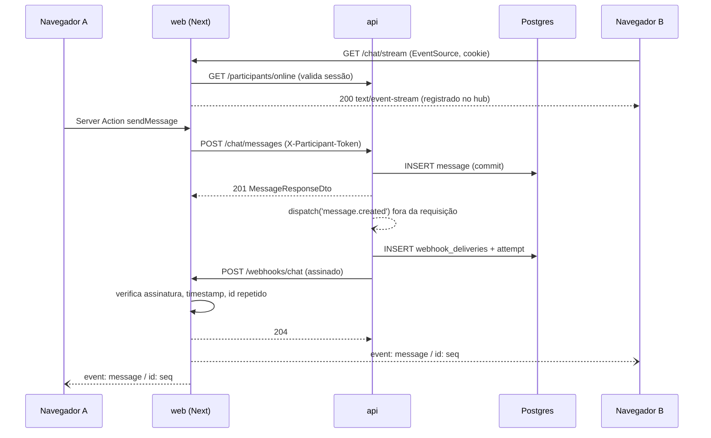
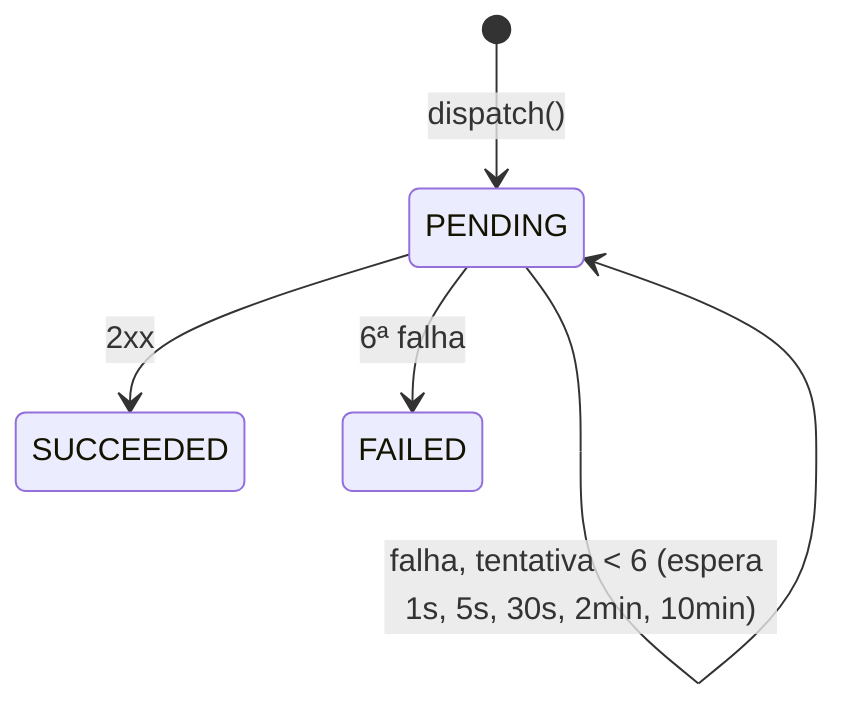

# Tempo real por webhooks e SSE (F2) Design

**Spec**: `.specs/features/chat-webhooks/spec.md`
**Status**: Draft

---

## Architecture Overview

A api ganha o módulo `webhooks`, que assina, envia, registra e retenta (AD-005). O módulo `chat` só chama `dispatch(type, data)` depois que a transação volta. No web, o receptor confere a assinatura e publica no hub em memória (AD-003); o hub escreve em cada stream SSE aberto. No navegador, `ChatStream.client` é o único dono do `EventSource` e do estado da sala.





---

## Code Reuse Analysis

### Existing Components to Leverage

| Component                                               | Location                            | How to Use                                                            |
| ------------------------------------------------------- | ----------------------------------- | --------------------------------------------------------------------- |
| `chat` (F1): services e `MessageMapper`                 | `apps/api/src/modules/chat/`        | Os services chamam o dispatcher com o DTO já mapeado                  |
| `IParticipantRepository.countOnline()`                  | `modules/chat/repositories/` (F1)   | Valor de `presence.changed`                                           |
| `env.schema.ts` + `AppConfigService`                    | `apps/api/src/common/config/`       | `WEBHOOK_TARGET_URL`, `WEBHOOK_SECRET`                                |
| Logger pino (`new Logger(Context.name)`)                | `apps/api/src/common/logger/`       | Uma linha por tentativa (`eventId`, tipo, tentativa, status, duração) |
| `getEnv()`                                              | `apps/web/src/lib/env.ts`           | Ganha `WEBHOOK_SECRET`                                                |
| `getValidSession()`                                     | `features/chat/session/` (F1)       | Autentica o stream                                                    |
| `ChatRoomView`, `ChatHeader`, `MessageList`, `Composer` | `features/chat/components/` (F0/F1) | Renderizados pelo `ChatStream.client`                                 |
| `ChatRoomContainer`                                     | `features/chat/containers/` (F1)    | Passa os dados iniciais ao `ChatStream.client`                        |

### Integration Points

| System          | Integration Method                                                                                                                                                                                                                              |
| --------------- | ----------------------------------------------------------------------------------------------------------------------------------------------------------------------------------------------------------------------------------------------- |
| api → web       | `POST {WEBHOOK_TARGET_URL}` (Standard Webhooks). No Compose: `http://web:3000/webhooks/chat`                                                                                                                                                    |
| web → navegador | `GET /chat/stream` (SSE)                                                                                                                                                                                                                        |
| Banco           | Migration `webhook_deliveries` + `webhook_delivery_attempts`                                                                                                                                                                                    |
| Makefile        | `make install` gera um `WEBHOOK_SECRET` e grava o mesmo valor nos dois `.env`                                                                                                                                                                   |
| Contrato        | O webhook não está no OpenAPI. O web valida o envelope com zod, e o schema de `data` de `message.created` é tipado como `z.ZodType<ChatMessage>` (alias do `Schemas['MessageResponseDto']`), então uma mudança no DTO quebra o typecheck do web |

---

## Components (api)

### Módulo `webhooks`

```
apps/api/src/modules/webhooks/
├── signing/            standard-webhooks.ts (funções puras)
├── services/           webhook-dispatcher.service.ts
├── http/               webhook-http-client.ts
├── repositories/       webhook-delivery.repository(.interface).ts
├── webhook.types.ts    WebhookEnvelope, WebhookEventType
└── webhooks.module.ts  exporta WebhookDispatcher
```

### `signing/standard-webhooks.ts`

- **Purpose**: Assinatura Standard Webhooks, sem estado (WHOUT-02 AC5).
- **Interfaces**:
  - `decodeSecret(secret: string): Buffer` — tira `whsec_` e decodifica o base64
  - `signWebhook(params: { key: Buffer; id: string; timestamp: number; body: string }): string` — `v1,` + base64(HMAC-SHA256(key, `${id}.${timestamp}.${body}`))
- **Testes**: o vetor oficial da especificação Standard Webhooks (conferir os valores no repositório `standard-webhooks/standard-webhooks` na task; não copiar de memória).

### `WebhookHttpClient`

- **Purpose**: Isolar o `fetch` para testar o dispatcher sem rede.
- **Interfaces**: `post(url: string, body: string, headers: Record<string, string>): Promise<{ status: number | null; durationMs: number; error: string | null }>` — `AbortSignal.timeout(5000)`; nunca lança (falha de rede/timeout vira `status: null` + `error`)

### `WebhookDispatcher`

- **Purpose**: Entregar um evento com assinatura, registro e retentativa (WHOUT-01 a 03).
- **Location**: `modules/webhooks/services/webhook-dispatcher.service.ts`
- **Interfaces**:
  - `dispatch<T>(type: WebhookEventType, data: T, options?: { maxAttempts?: number }): void` — síncrono para quem chama. Gera `eventId` (uuid), serializa o envelope `{ type, occurredAt, data }` uma vez e agenda a 1ª tentativa com `setImmediate`. Erros internos são logados, nunca propagados.
  - `RETRY_DELAYS_MS = [1_000, 5_000, 30_000, 120_000, 600_000]`; `maxAttempts` padrão `6`
  - Cada tentativa: novo `webhook-timestamp` e nova assinatura, mesmo `webhook-id` e mesmo corpo (WHOUT-02 AC6) → `recordAttempt` → `2xx` marca `SUCCEEDED`; falha agenda a próxima ou marca `FAILED`
  - `onApplicationShutdown()`: cancela os timers pendentes (testes e2e e `make dev` não ficam presos)
- **Dependencies**: `AppConfigService`, `IWebhookDeliveryRepository`, `WebhookHttpClient`, `Logger`
- **Testes**: `vi.useFakeTimers()` para as esperas; `WebhookHttpClient` falso

### `IWebhookDeliveryRepository`

- `create(data: { eventId; eventType; payload }): Promise<WebhookDelivery>`
- `recordAttempt(deliveryId: string, attempt: { number; statusCode: number | null; durationMs; error: string | null }): Promise<void>` — `$transaction`: insere a tentativa e atualiza `attempts`, `lastStatus`, `lastError`
- `markStatus(deliveryId: string, status: 'SUCCEEDED' | 'FAILED'): Promise<void>`

### Mudanças no `chat`

- `chat.module.ts` importa `WebhooksModule`.
- `MessagesService.send`: depois de gravar, `dispatcher.dispatch('message.created', dto)`.
- `ParticipantsService.join`/`leave`: depois da transação, `dispatch('message.created', joinOrLeftDto)` e `dispatch('presence.changed', { online: await repo.countOnline() })`, nessa ordem.
- Nada no `chat` conhece URL nem segredo (WHOUT-04 AC13).

### Configuração

- `env.schema.ts`: `WEBHOOK_TARGET_URL: z.url()`; `WEBHOOK_SECRET: z.string().regex(/^whsec_[A-Za-z0-9+/]+={0,2}$/)` (WHOUT-04 AC12).
- `.env.example` (api e web): `WEBHOOK_SECRET=<webhook-secret>`; a api também `WEBHOOK_TARGET_URL=http://localhost:3000/webhooks/chat`.
- `openapi.ts` (modo preview) passa valores fictícios, como já faz com a `DATABASE_URL`.
- e2e da api: `WEBHOOK_TARGET_URL` aponta para um servidor HTTP de teste (`env` do project `e2e` no `vitest.config.ts`, porta fixa `4599`).

---

## Components (web)

### `realtime/` (server-only)

```
apps/web/src/features/chat/realtime/
├── chat-hub.ts              ChatHub + getChatHub() (singleton em globalThis)
├── sse.ts                   formatSseEvent(), SSE_HEARTBEAT, SSE_HEADERS
├── verify-webhook.ts        verifyWebhook() (pura)
├── recent-ids.ts            RecentIds (capacidade 1000)
├── handle-chat-webhook.ts   handleChatWebhook(request)
└── open-chat-stream.ts      openChatStream(request)
```

#### `ChatHub`

- **Purpose**: Ligar webhooks a conexões SSE dentro do processo.
- **Interfaces**:
  - `type HubEvent = { type: 'message.created'; data: ChatMessage } | { type: 'presence.changed'; data: { online: number } }`
  - `interface HubConnection { participantId: string; token: string; write(chunk: string): void }`
  - `subscribe(conn: HubConnection): () => void` — devolve `unsubscribe`
  - `publish(event: HubEvent): void` — formata uma vez e escreve em todas; um `write` que lança remove só aquela conexão (edge case "navegador desconecta enquanto o hub escreve")
  - `connectionCount(participantId?: string): number`
  - `getChatHub(): ChatHub` — `globalThis[Symbol.for('web-hook.chat-hub')] ??= new ChatHub()`
- A F3 acrescenta o buffer de recuperação e a saída por desconexão.

#### `sse.ts`

- `formatSseEvent({ event, data, id? }): string` — `id: …\n` só quando há id; `data:` com `JSON.stringify`; termina com `\n\n`
- `SSE_HEARTBEAT = ': heartbeat\n\n'`, `HEARTBEAT_MS = 25_000`
- `SSE_HEADERS = { 'content-type': 'text/event-stream', 'cache-control': 'no-cache, no-transform', 'x-accel-buffering': 'no', connection: 'keep-alive' }`

#### `verifyWebhook`

- **Interfaces**: `verifyWebhook(params: { id: string | null; timestamp: string | null; signature: string | null; rawBody: string; secret: string; nowSeconds: number }): { ok: true } | { ok: false; reason: 'missing' | 'timestamp' | 'signature' }`
  - `|now − timestamp| > 300` → `timestamp` (WHIN-01 AC3)
  - Aceita várias assinaturas separadas por espaço (formato da especificação); compara cada `v1,…` com `crypto.timingSafeEqual` sobre buffers de mesmo tamanho
- Reaproveita a mesma lógica da api? Não: a api assina, o web verifica; cada app tem a sua função de 10 linhas (regra "um pacote só existe com 2+ usos de código igual", e aqui as funções são diferentes).

#### `handleChatWebhook`

- **Interfaces**: `handleChatWebhook(request: Request): Promise<Response>`
  1. `rawBody = await request.text()` (WHIN-01 AC1)
  2. `verifyWebhook(...)` → falha → `log.warn` sem corpo → `401`
  3. `webhookEnvelopeSchema.safeParse(JSON.parse(rawBody))` → falha → `400` (AC4)
  4. `recentIds.has(id)` → `204` sem publicar (AC5)
  5. `recentIds.add(id)`; `getChatHub().publish(envelope)`; `204` (AC6)
- Nenhuma chamada de rede (AC7). O `RecentIds` também mora no `globalThis` (mesmo motivo do hub).

#### `openChatStream`

- **Interfaces**: `openChatStream(request: Request): Promise<Response>`
  - `getValidSession()` → `null` → `401` (SSE-01 AC1)
  - `new ReadableStream({ start(controller) { … }, cancel() { … } })`: registra no hub, escreve `retry: 3000` e liga o heartbeat (`setInterval(25s)`)
  - `request.signal` `abort` e `cancel()` → `unsubscribe()` + `clearInterval` (SSE-01 AC6)
  - Responde `200` com `SSE_HEADERS` (AC2)
- Ler `cookies()` torna o handler dinâmico com Cache Components; a task confere no `next build` que `/chat/stream` aparece como dinâmica (AC7).

### Rotas

- `app/webhooks/chat/route.ts`: `export const POST = (request: Request) => handleChatWebhook(request)`
- `app/chat/stream/route.ts`: `export const GET = (request: Request) => openChatStream(request)`
- O `proxy.ts` (F1) não casa nenhuma das duas.

### `schemas/webhook-envelope.schema.ts`

- `messageSchema: z.ZodType<ChatMessage>`
- `webhookEnvelopeSchema = z.discriminatedUnion('type', [ { type: 'message.created', occurredAt, data: messageSchema }, { type: 'presence.changed', occurredAt, data: { online: int ≥ 0 } } ])` — a F4 acrescenta `typing.started`

### Estado da sala no navegador

#### `state/chat-room.reducer.ts` (pura)

- **Purpose**: Uma regra só para inserir, ordenar e deduplicar (SSE-02 AC9-10).
- **Interfaces**:
  - `type ChatRoomState = { messages: ChatMessage[]; online: number }`
  - `type ChatRoomAction = { type: 'message/received'; message: ChatMessage } | { type: 'presence/changed'; online: number }`
  - `chatRoomReducer(state, action): ChatRoomState` — `message/received` com `seq` presente → mesmo estado; senão insere na posição de `seq` (busca binária)
  - `initChatRoom({ messages, online }): ChatRoomState`
- A F3 e a F4 acrescentam ações (otimista, conexão, digitando, anteriores).

#### `state/use-chat-events.ts`

- **Interfaces**: `useChatEvents(handlers: { onMessage(m: ChatMessage): void; onPresence(online: number): void }, options?: { url?: string; createEventSource?: (url: string) => EventSource }): void`
  - Abre um `EventSource('/chat/stream')` no `useEffect`, faz `JSON.parse` dos eventos `message`/`presence` e fecha no unmount
  - Sem reconexão manual: o `EventSource` reconecta sozinho (SSE-03 AC12)
  - `createEventSource` existe para os testes (o jsdom não tem `EventSource`)

#### `ChatStream.client` (`components/chat-stream.client.tsx`)

- **Purpose**: Único componente com `EventSource` (SSE-02 AC8); dono do estado da Sala.
- **Interfaces**: `ChatStream({ me, initialMessages, initialOnline, actions }: { me: { id; name }; initialMessages: ChatMessage[]; initialOnline: number; actions: { send: SendMessageAction; leave: LeaveAction } })`
  - `useReducer(chatRoomReducer, …, initChatRoom)` + `useChatEvents`
  - Renderiza `ChatRoomView` com `ChatHeader online={state.online}`, `MessageList messages={state.messages}`, `Composer`
  - Após enviar, não chama nada: a mensagem chega pelo SSE (premissa da spec)
- **Story**: com `createEventSource` falso que emite eventos no `play`
- `ChatRoomContainer` passa a renderizar `ChatStream` no lugar da montagem manual.
- `sendMessage` remove o `refresh()`.

### Ambiente e infraestrutura

- `lib/env.ts`: `WEBHOOK_SECRET` com a mesma regex da api.
- `src/instrumentation.ts`: `register()` chama `getEnv()` quando `NEXT_RUNTIME === 'nodejs'` e `NEXT_PHASE !== 'phase-production-build'`, para o web não subir com segredo inválido (WHIN-03 AC8) sem exigir o `.env` no build.
- `test/setup.ts`: `process.env.WEBHOOK_SECRET = TEST_WEBHOOK_SECRET`; helper `signTestWebhook()` em `test/webhooks.ts` para os testes do receptor.
- `Makefile`: alvo `env` gera o segredo uma vez por execução (`WEBHOOK_SECRET := whsec_$(shell node -e "…randomBytes(32)…")`) e o `sed` troca `<webhook-secret>` nos dois `.env.example` (WHIN-03 AC9).
- `docker-compose.yml`: `api.environment.WEBHOOK_TARGET_URL: http://web:3000/webhooks/chat` (o container do web sempre escuta na 3000; `WEB_PORT` só muda a porta do host).

---

## Data Models

```prisma
enum WebhookDeliveryStatus {
  PENDING
  SUCCEEDED
  FAILED
}

model WebhookDelivery {
  id         String                   @id @default(uuid())
  eventId    String                   @unique @map("event_id")
  eventType  String                   @map("event_type")
  payload    Json
  status     WebhookDeliveryStatus    @default(PENDING)
  attempts   Int                      @default(0)
  lastStatus Int?                     @map("last_status")
  lastError  String?                  @map("last_error")
  createdAt  DateTime                 @default(now()) @map("created_at")
  updatedAt  DateTime                 @updatedAt @map("updated_at")
  history    WebhookDeliveryAttempt[]

  @@index([status])
  @@map("webhook_deliveries")
}

model WebhookDeliveryAttempt {
  id         String          @id @default(uuid())
  deliveryId String          @map("delivery_id")
  delivery   WebhookDelivery @relation(fields: [deliveryId], references: [id], onDelete: Cascade)
  attempt    Int
  statusCode Int?            @map("status_code")
  durationMs Int             @map("duration_ms")
  error      String?
  createdAt  DateTime        @default(now()) @map("created_at")

  @@unique([deliveryId, attempt])
  @@map("webhook_delivery_attempts")
}
```

```typescript
interface WebhookEnvelope<T> {
  type: 'message.created' | 'presence.changed';
  occurredAt: string; // ISO
  data: T;
}
```

**Relationships**: `WebhookDelivery 1—N WebhookDeliveryAttempt`. O `payload` guarda o envelope inteiro.

---

## Error Handling Strategy

| Error Scenario                             | Handling                                                        | User Impact                                                                         |
| ------------------------------------------ | --------------------------------------------------------------- | ----------------------------------------------------------------------------------- |
| Web fora do ar quando a mensagem é gravada | `201` imediato; tentativas em segundo plano; `FAILED` após a 6ª | Quem envia não percebe; os outros recebem quando o web voltar ou ao reconectar (F3) |
| Timeout de 5 s                             | Tentativa registrada com `statusCode: null`, `error: 'timeout'` | —                                                                                   |
| Assinatura ausente ou errada               | `401`, `warn` no log, nada publicado                            | —                                                                                   |
| Corpo fora do envelope                     | `400`                                                           | —                                                                                   |
| Mesmo `webhook-id` duas vezes              | `204` sem publicar; e o navegador ignora `seq` repetido         | Mensagem aparece uma vez                                                            |
| Stream sem sessão válida                   | `401`; o `EventSource` tenta de novo pelo `retry`               | Nada visível (a página já redireciona se a sessão caiu)                             |
| Navegador fecha durante o `write`          | O hub remove só aquela conexão                                  | Os outros seguem recebendo                                                          |
| Webhook sem nenhuma conexão aberta         | `204`, evento descartado                                        | —                                                                                   |

---

## Risks & Concerns

| Concern                                                                                           | Location (file:line)                 | Impact                                              | Mitigation                                                                              |
| ------------------------------------------------------------------------------------------------- | ------------------------------------ | --------------------------------------------------- | --------------------------------------------------------------------------------------- |
| Módulos dos route handlers e das Server Actions podem ser instâncias diferentes no bundle do Next | `features/chat/realtime/chat-hub.ts` | O webhook publicaria num hub sem conexões           | Singleton em `globalThis` (AD-003); teste E2E A→B confirma                              |
| Cache Components pode pré-renderizar o `GET /chat/stream`                                         | `app/chat/stream/route.ts`           | Stream vira resposta estática no build              | O handler lê `cookies()` (runtime data); conferir na saída do `next build` (SSE-01 AC7) |
| Timers do dispatcher vivos no fim dos testes e2e                                                  | `webhook-dispatcher.service.ts`      | Vitest não termina ou vaza entre testes             | `onApplicationShutdown` cancela timers; o e2e chama `app.close()`                       |
| Teste e2e de retentativa espera 1 s + 5 s                                                         | `apps/api/test/webhooks.e2e-spec.ts` | Teste lento (≈ 6 s)                                 | Aceito (é o comportamento real); timeout do teste em 15 s                               |
| `WEBHOOK_SECRET` diferente entre api e web se só um `.env` for recriado                           | `Makefile`                           | Todos os webhooks recusados com `401`               | O `warn` do receptor diz "assinatura inválida"; README explica recriar os dois          |
| Dependência circular no Compose (web depende da api, api chama o web)                             | `docker-compose.yml`                 | Primeiros webhooks podem falhar enquanto o web sobe | A retentativa cobre; não há mensagem antes do web estar no ar                           |
| `instrumentation.ts` rodando no `next build`                                                      | `src/instrumentation.ts`             | Build no Docker sem `.env` falharia                 | Guardar com `NEXT_PHASE`; conferir com `docker build` do web                            |
| Vetores de teste do Standard Webhooks citados de memória                                          | `signing/standard-webhooks.spec.ts`  | Teste "passa" com vetor errado                      | Buscar os valores no repositório oficial na task (Knowledge Verification Chain)         |
| Proxies e buffering                                                                               | rede                                 | Eventos chegam em lote                              | `x-accel-buffering: no`, `cache-control: no-transform` e heartbeat de 25 s              |

---

## Tech Decisions

| Decision                     | Choice                                      | Rationale                                                                                 |
| ---------------------------- | ------------------------------------------- | ----------------------------------------------------------------------------------------- |
| Histórico das tentativas     | Tabela `webhook_delivery_attempts`          | Premissa da spec; o model do PRD só guarda a última                                       |
| `dispatch` síncrono          | Agenda com `setImmediate` e devolve `void`  | Garante que a resposta HTTP nunca espera o webhook (WHOUT-01 AC3)                         |
| HTTP do dispatcher           | `WebhookHttpClient` injetável sobre `fetch` | Testes sem rede; timeout num lugar só                                                     |
| Retentativa do `EventSource` | `retry: 3000` no início do stream           | Valor explícito em vez do padrão do navegador                                             |
| Estado da sala               | `useReducer` com reducer puro               | Toda regra de ordem e duplicação testada sem DOM; F3 e F4 só acrescentam ações            |
| Envelope do webhook no web   | zod com `data` tipado pelo contrato         | O webhook não está no OpenAPI; o typecheck ainda pega mudança no DTO                      |
| Validação do segredo no web  | `instrumentation.ts`                        | O `getEnv()` é sob demanda (convenção do web); o `register()` força a validação na subida |
